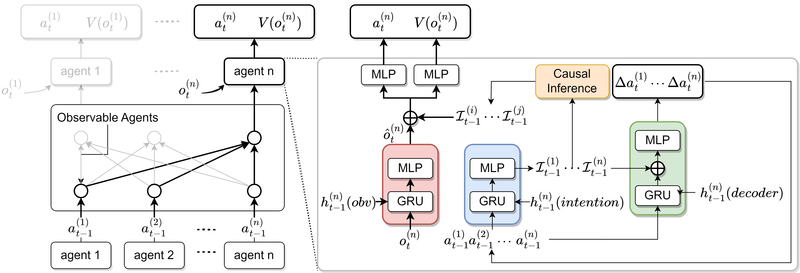

<div align="center">

# Deep Motor System (DMS)

### Coordination as Inference in Multi-Agent Reinforcement Learning

<p>Zhiyuan Li · Lijun Wu · Kaile Su · Wei Wu · Yulin Jing<br>Tong Wu · Weiwei Duan · Xiaofeng Yue · Xiyi Tong · Yizhou Han</p>

**Neural Networks, Volume 172, Article 106101, 2024**

[**Paper**](https://www.sciencedirect.com/science/article/pii/S0893608024000157) ·
[**DOI**](https://doi.org/10.1016/j.neunet.2024.106101) ·
[**Documentation**](docs/METHOD_WALKTHROUGH.md) ·
[**BibTeX**](#citation) ·
[**Original Implementation**](https://github.com/LiZhYun/DMS/tree/legacy-paper-code)

[](https://github.com/LiZhYun/DMS/actions/workflows/tests.yml)
[](#installation)
[](https://doi.org/10.1016/j.neunet.2024.106101)
[](LICENSE)

</div>

---

DMS studies how independent reinforcement learning agents can coordinate by
inferring one another’s intentions from observed behavior. This repository
provides a documented implementation of intention inference, behavior prediction,
and selective coordination, together with training and evaluation utilities for
cooperative multi-agent tasks.

<p align="center">
  
</p>
<p align="center">
  <em>Architecture of Deep Motor System from Li et al., Neural Networks (2024).</em>
</p>

## Contents

- [Overview](#overview)
- [Installation](#installation)
- [Quick Start](#quick-start)
- [Benchmarks](#benchmarks)
- [Documentation](#documentation)
- [Repository Structure](#repository-structure)
- [Validation](#validation)
- [Citation](#citation)
- [Acknowledgements](#acknowledgements)
- [License](#license)

## Overview

DMS addresses coordination under independent learning through two complementary
components:

1. **Individual intention inference.** Each observer maintains a conditional
   generative model of locally observed action histories. A prior infers latent
   intentions from past behavior; a training-only posterior and an autoregressive
   decoder learn from completed future behavior.
2. **Selective coordination.** Each agent conditions its actor and critic on
   relevant inferred peer intentions. The implementation provides the paper’s
   policy-KL selection criterion, a soft-attention alternative, and an all-peer
   comparison.

Actors and critics operate on local information. Unobserved actions remain
masked, and future action targets are excluded from decision-time inputs.

| Configuration | Coordination mechanism |
| --- | --- |
| `coordination="causal"` | Select peers using the KL divergence between the full policy and the policy with one peer’s intention removed |
| `coordination="soft"` | Aggregate available peer intentions through attention |
| `coordination="all"` | Condition on all available peer intentions |
| `algorithm="ippo"` | Independent PPO baseline without intention conditioning |

The causal score measures policy sensitivity to a peer’s inferred intention; it
does not by itself identify that peer’s causal effect on episode return.

**Implementation scope.** The figure depicts the published architecture. The
current code preserves its inference and coordination mechanisms while making
mathematical corrections and implementation choices explicit. Independent PPO is
the default learning base; a HAPPO-style sequential update is also available.
See [implementation decisions](docs/IMPLEMENTATION_DECISIONS.md) for finite
histories, deterministic prior features, loss normalization, and other changes.
The original paper code remains available on
[`legacy-paper-code`](https://github.com/LiZhYun/DMS/tree/legacy-paper-code).

## Installation

The documented environment uses **Python 3.10** and **PyTorch 2.6**. The synthetic
example runs on CPU without StarCraft II or MuJoCo.

```bash
git clone https://github.com/LiZhYun/DMS.git
cd DMS

python3.10 -m venv .venv
source .venv/bin/activate
python -m pip install --upgrade pip
python -m pip install torch==2.6.0 --index-url https://download.pytorch.org/whl/cpu
python -m pip install -e '.[test]'
```

For GPU training, install the corresponding PyTorch CUDA wheel instead of the CPU
wheel. The measured Triton environment uses PyTorch 2.6 with CUDA 12.6; additional
setup instructions are in the [environment reference](docs/READER_REFERENCE.md).

### Optional benchmark dependencies

| Benchmark | Installation and environment requirements |
| --- | --- |
| Modern Multi-Agent MuJoCo | `python -m pip install -c requirements/modern-constraints.txt -e '.[test,mujoco]'` |
| Original SMAC | Official SMAC package, maps, and StarCraft II 4.10; follow the [SMAC setup guide](docs/READER_REFERENCE.md#install) and [environment record](docs/SMAC_ENVIRONMENT.md) |
| Historical Multi-Agent MuJoCo | Separate Gym-v2 compatibility environment; follow the [native setup](docs/PORTABLE_LEGACY_SETUP.md) or [container guide](containers/README.md) |

## Quick Start

### Train DMS

```bash
python -m dms.train --config configs/toy_smoke.json \
  --device cpu --output runs/toy-dms
```

The example completes 512 environment transitions. It exercises collection,
policy optimization, intention learning, evaluation, and checkpoint saving.
Each run records its resolved configuration, source snapshot, environment
metadata, metrics, evaluation episodes, and checkpoint. Use a fresh output
directory for every run.

### Compare coordination variants

```bash
# Independent PPO baseline
python -m dms.train --config configs/toy_smoke.json \
  --algorithm ippo --device cpu --output runs/toy-ippo

# DMS with policy-KL peer selection
python -m dms.train --config configs/toy_causal_smoke.json \
  --device cpu --output runs/toy-dms-causal
```

The causal example activates the selection rule immediately, without the
benchmark warmup. Its selected peer set may be empty. These short examples
validate execution and are not benchmark performance measurements.

### Evaluate a checkpoint

```bash
PYTHONPATH=runs/toy-dms/source python -m dms.evaluate \
  --checkpoint runs/toy-dms/latest.pt \
  --episodes 10 --seed 20001 --device cpu \
  --output runs/toy-dms/checkpoint-evaluation.json
```

Evaluation loads the training run’s saved source and uses fresh episode seeds
with frozen model parameters and normalization statistics.

## Benchmarks

The environment interfaces cover the following task families:

| Environment | Tasks | Track |
| --- | --- | --- |
| SMAC | `3s5z`, `8m_vs_9m`, `MMM2` | StarCraft II 4.10 with native local observations and visible ally-action sensors |
| Multi-Agent MuJoCo | Ant, HalfCheetah, Walker2d with multiple agent partitions | Historical Gym-v2 compatibility backend and a separate modern Gymnasium-v5 adaptation |
| ManyAgentSwimmer | `10x2` | Supplementary parameter-study environment |

Generate matched configuration files with an explicit training budget:

```bash
python -m dms.benchmark_configs \
  --output-dir configs/my-experiments \
  --steps 3000000 --include-ablations
```

This command generates configurations only. It defaults to the modern MuJoCo
track; add `--mamujoco-backend legacy` for historical compatibility configurations.
Training and evaluation must use the matching simulator dependencies.

Historical and modern environment tracks are reported separately. The
manuscript’s observation-radius ambiguity and remaining simulator-comparability
questions are documented in the [paper contract](docs/PAPER_CONTRACT.md).
Existing development results are available in the [status record](docs/STATUS.md);
this release does not claim complete replication of the paper’s performance.

## Documentation

| Topic | Guide |
| --- | --- |
| Algorithm, equations, and tensor dimensions | [One training iteration](docs/METHOD_WALKTHROUGH.md) |
| Manuscript correspondence and mathematical corrections | [Paper contract](docs/PAPER_CONTRACT.md) · [Implementation decisions](docs/IMPLEMENTATION_DECISIONS.md) |
| Training, evaluation, CUDA, and Triton commands | [Extended reader reference](docs/READER_REFERENCE.md) |
| Original SMAC and historical MuJoCo environments | [SMAC](docs/SMAC_ENVIRONMENT.md) · [MuJoCo](docs/HISTORICAL_ENVIRONMENT.md) |
| Sequential policy optimization | [HAPPO-style update](docs/SEQUENTIAL_POLICY_UPDATE.md) |
| Optional research extensions | [Local policy memory](docs/LOCAL_POLICY_MEMORY.md) · [Residual inputs](docs/RESIDUAL_INTENTIONS.md) · [Joint intention training](docs/JOINT_INTENTION_TRAINING.md) |
| Validation, development evidence, and limitations | [Release status](docs/STATUS.md) |

## Repository Structure

```text
src/dms/          Intention models, policies, environments, and training loop
configs/          Runnable examples and benchmark configurations
scripts/          Evaluation diagnostics and Triton launchers
tests/            Mathematical, information-flow, and integration checks
docs/             Method walkthroughs and environment documentation
containers/       Historical MuJoCo runtime support
```

For the core implementation, read `intention.py` → `policy.py` → `train.py`.
[The walkthrough](docs/METHOD_WALKTHROUGH.md) explains the complete data flow.

## Validation

```bash
python -m pytest tests -q
```

The suite checks variational inference, visibility masking, sequence boundaries,
policy likelihood replay, legal actions, timeout handling, and checkpoint
loading. Optional native-simulator checks require their corresponding runtime.
[GitHub Actions](https://github.com/LiZhYun/DMS/actions/workflows/tests.yml)
installs the CPU environment, runs the tests, and builds the package.

The [community validation record](reports/community-release-validation.json)
reports **545 passed tests and 32 optional checks skipped**, plus wheel
installation and saved-source evaluation of the IPPO, soft-DMS, and causal-DMS
examples. These checks establish software behavior, not a benchmark ranking.

## Citation

If you use DMS in your research, please cite:

```bibtex
@article{li2024coordination,
  title = {Coordination as inference in multi-agent reinforcement learning},
  author = {Li, Zhiyuan and Wu, Lijun and Su, Kaile and Wu, Wei and Jing, Yulin and Wu, Tong and Duan, Weiwei and Yue, Xiaofeng and Tong, Xiyi and Han, Yizhou},
  journal = {Neural Networks},
  volume = {172},
  pages = {106101},
  year = {2024},
  doi = {10.1016/j.neunet.2024.106101},
  url = {https://www.sciencedirect.com/science/article/pii/S0893608024000157}
}
```

## Acknowledgements

This work uses [SMAC](https://github.com/oxwhirl/smac),
[Multi-Agent MuJoCo](https://github.com/schroederdewitt/multiagent_mujoco),
and the Gym/Gymnasium and MuJoCo ecosystems. Adapted source and benchmark assets
are credited in [third-party notices](THIRD_PARTY_NOTICES.md).

## License

The software is released under the [MIT License](LICENSE). Simulator assets and
the paper’s illustrations retain their respective licensing terms; figure
provenance is recorded in [docs/assets](docs/assets/README.md).
