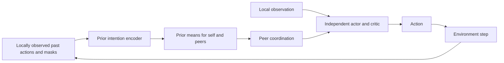
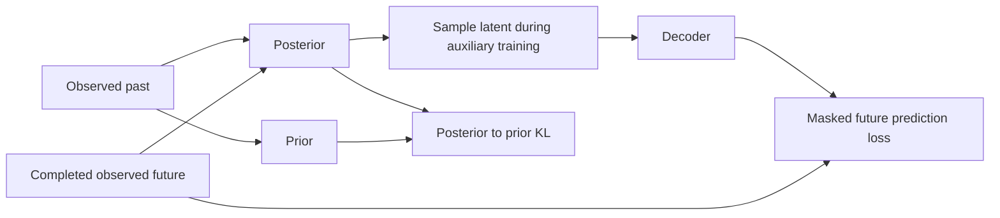

# One DMS training iteration

Start with `configs/toy_smoke.json` and [train.py](../src/dms/train.py). The same loop drives the small synthetic task, MuJoCo, and SMAC. An environment adapter changes what is sensed and how actions are executed; it does not change the inference or PPO update.

## What one agent knows

Each observer has its own policy, critic, and intention model. It receives a local observation and a rolling window of locally sensed actions. A separate visibility mask says which peer actions were observed. An unobserved command is not a zero command: the mask distinguishes the two. The environment adapter removes hidden control components before they enter that observer's data.

The critic uses the same local information as the actor. No global state is supplied. In MuJoCo, the locally sensed previous-control channel is an explicit reproduction assumption, shared with IPPO; native joint observations alone do not contain actuator commands. [The paper contract](PAPER_CONTRACT.md) explains this assumption and the manuscript's conflicting observation radii.

## 1. Collect with the prior

`Learner.contexts` normalizes local observations, optionally selects the long or short history, and computes intention features from the **prior mean**. It does not sample a posterior or inspect upcoming actions. The observer's own intention can supply the attention query; its peer set excludes itself.

`IndependentAgent` in [policy.py](../src/dms/policy.py) supports three coordination rules:

| Rule | Policy conditioning |
| --- | --- |
| `soft` | Weighted sum of visible peer intentions, with learned query/key attention |
| `all` | Concatenated visible peer intentions, with zeros for unavailable peers |
| `causal` | Concatenated peer intentions selected by policy KL sensitivity to removing each peer |

The paper calls the third rule causal selection. Its implemented statistic is policy-distribution sensitivity; it is not an identified causal effect on return. A disclosed additional warmup lets this policy learn sensitivity before hard gating. With only two agents there is at most one peer, so soft attention cannot demonstrate ranking among peers.

Coordination chooses the peer context; `intention_fusion` determines how that
context enters the networks. The default `concat` appends it to the local
features. Optional [residual fusion](RESIDUAL_INTENTIONS.md) adds separate
actor/critic projections to their local features. Those projections start at
zero, so the initial local policy matches IPPO. This initialization property
does not promise identical subsequent learning. With optional
[local policy memory](LOCAL_POLICY_MEMORY.md), the local features come from
separate actor and critic GRUs over the observer's own observation window.

The collector stores the normalized observations, intention features, gates, sampled actions, log probabilities, and values that actually produced the rollout. Action masks exclude illegal discrete actions. Continuous policies sample only real actuator coordinates; adapters clip executed controls and pad heterogeneous actions only at the environment interface.

## 2. Update the policy on fixed rollout inputs

`update` computes advantages and applies independent PPO updates by default. The optional [sequential mode](SEQUENTIAL_POLICY_UPDATE.md) trains agents in random order and weights each actor surrogate by the completed predecessors' detached likelihood ratios. With the default `intention_rl_lr=0`, both modes reuse the collection-time intention features and gates. Policy gradients update the actor, critic, and attention parameters. Optional [joint intention training](JOINT_INTENTION_TRAINING.md) also trains the intention encoder by recomputing prior features from the same locally observed past; it preserves the original filter masks and gates in PPO.

[returns.py](../src/dms/returns.py) treats true termination and a time limit differently. A time limit can bootstrap from the final observation; a true terminal state cannot. Neither case joins the next episode's reward sequence. Observation histories are cleared on reset. PopArt changes value normalization while preserving the critic's raw prediction when its statistics change.

## 3. Learn intentions from completed windows

After the PPO update, the auxiliary update samples past/future action windows that stay inside one episode. The posterior can now use the completed future as a **training target**. The decoder predicts those observed future actions, and a KL term trains the prior to agree with the posterior.

By default, one call to `update` finishes **all PPO epochs and minibatches for all
agents**, then calls `update_intentions` once. `aux_updates=2` means two
auxiliary optimizer steps per observer after that complete rollout update,
using up to `aux_batch_size` completed windows per step. It does not mean two
auxiliary steps before every PPO minibatch. This is the implemented schedule;
the manuscript's delayed actor updates and soft intention updates are recorded
separately in [the implementation decisions](IMPLEMENTATION_DECISIONS.md).

The optional [auxiliary-first schedule](AUXILIARY_ORDER.md) instead fits each
observer's intention model immediately before its PPO epochs, then rebuilds
detached prior features from the original filtered past. Collected behavior
log probabilities and peer gates remain fixed. This is an experimental
schedule; it has not established improved benchmark return.

The default decoder also receives encoded history. The `decoder_history=false` development variant initializes it from the latent alone, while retaining the last observed action anchor and autoregressive action feedback. This distinction matters when diagnosing whether prediction accuracy actually depends on the latent.

The implemented loss averages reconstruction NLL over valid time/peer targets and KL over eligible peer sequences. Thus `kl_beta=1` is a time-normalized beta objective, not automatically the canonical sequence ELBO. [INTENTION_DIAGNOSIS.md](INTENTION_DIAGNOSIS.md) gives the reductions and explains the recorded development trials. Future targets never become decision-time actor or critic inputs.

## 4. Evaluate a fixed policy

Evaluation uses deterministic actions, fresh episode seeds, frozen parameters, and frozen normalization statistics. Histories still update from the current episode's local sensors. Training-time evaluations are development diagnostics; the final protocol uses separate seeds and a fixed final training checkpoint.

A useful intention representation should predict better than simple history baselines, change when relevant histories change, and help the policy during complete episodes. Forecast loss alone does not establish this. [INTERVENTION_DIAGNOSTICS.md](INTERVENTION_DIAGNOSTICS.md) describes the separate frozen-policy probes and their limits.

The prediction diagnostic reports both `forecast` (self and peers together)
and `forecast_peer_only` (other agents only), with sample counts for each.
Accurate prediction of an observer's own actions cannot supply evidence for
the peer-only result. Both retain the same local visibility masks.

## Tensor axes

| Object | Axes |
| --- | --- |
| Environment observations | `environment, observer, observation_feature` |
| Optional local observation window | `environment, observer, policy_history_time, observation_feature_plus_validity` |
| Action history | `environment, history_time, observer, peer, action_feature` |
| History visibility | `environment, history_time, observer, peer` |
| Prior features for a decision | `environment, observer, peer, latent_feature` |
| One observer's auxiliary batch | `window, time, peer, action_feature` |

The intention model shares its sequence encoder across peers **within one observer**. Different observers have separate model parameters. IPPO uses the same local observations and sensed controls, but skips intention conditioning and auxiliary updates. The current [status](STATUS.md) separates implementation checks from unfinished benchmark acceptance.

The observation-window validity bit stays exactly zero or one through
normalization. The action-history visibility mask has a different role: it
states whether that observer sensed each peer action at that time.
